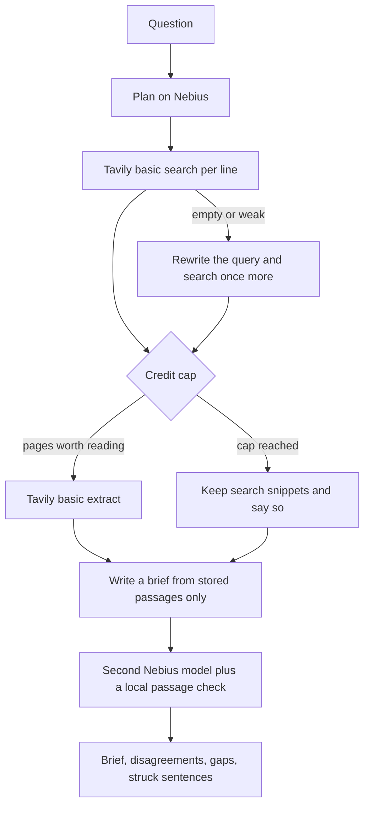

# SourceTrail

SourceTrail is a research notebook. You file one question. It plans a few lines of inquiry, searches the web, reads the strongest pages, and files a short brief in which every factual sentence points at a verbatim passage. A second pass checks those sentences against the passages and strikes anything they do not support.

It was built for the [ODSC × Nebius hackathon](https://hackathon.odsc.ai).

## Who it is for

A reporter, student, or analyst who needs a short, checkable brief and would rather see an honest gap than a fluent guess. The page is a notebook, not a chat. The research trail in the left margin is the product: queries, retries, pages kept, and pages discarded stay visible.

The interface is in English. The brief is written in the language of the question.

## How a question moves



No page is stored. There is no database. Closing the tab drops the brief, unless you copied or downloaded the Markdown.

### The agent loop

1. **Plan.** The primary model splits the question into 3–5 sub-questions and decides whether recency matters. When it does, Tavily is called with `topic: "news"` and a `time_range` of day, week, month, or year.
2. **Search.** Each line gets a basic Tavily search (1 credit). Empty or weak results are rewritten and searched once more. Two rounds per line, and the run stops spending before it can pass the credit cap.
3. **Read.** Up to five of the strongest URLs are sent to Tavily Extract (`extract_depth: "basic"`, plain text). Verbatim chunks are stored with URL, title, publisher, and published date. If extract fails or the cap cannot afford it, the search snippet is kept and labeled as a snippet.
4. **Write.** The primary model may use only those stored passages. The direct answer comes first. Each sentence is a `fact` with citation ids, or an `inference`. Inferences may not introduce numbers or names that are not in the passages.
5. **Verify.** A different Nebius model reviews each sentence. A local entailment check then runs on the same passages: missing figures or names are unsupported even if the model approved them. Unsupported factual sentences are struck and listed. Partial matches stay, marked “Check”.
6. **Honesty.** If sources assert incompatible claims, both sides are shown under “Sources disagree”. If the pages do not answer the question, the brief says so and lists what was searched. If every search fails, no brief is filed.

Model output is parsed as JSON, validated, and repaired once. A second invalid reply stops that phase in the open. Nebius and Tavily errors and timeouts are written into the trail. The brief is emitted only after verification, so a dropped connection does not leave an unchecked draft on the page.

## Cost safety

Nebius Token Factory can bill a card if the balance goes negative. Tavily’s pay-as-you-go plan can do the same after the free 1,000 credits. This app tries to stay small, and it still cannot see your provider dashboards. Before a public deploy:

- Put a spend cap on the Nebius balance, or keep the balance prepaid and watch it.
- In Tavily, leave pay-as-you-go off unless you intend to be charged past the free plan.
- Set `SOURCETRAIL_DISABLED=1` the moment you want the desk to stop. The page shows a paused notebook and the API refuses new questions.

What the code enforces on every request:

| Guard | Default | Hard ceiling |
| --- | --- | --- |
| Questions per IP per hour | 6 | 24 |
| Questions per UTC day, per server instance | 24 | 48 |
| Tavily credits budgeted per question | 8 | 10 |
| Question length | 500 characters | 2,000 |
| Request body | 8 KB | 8 KB |
| Plan `max_tokens` | 700 | 1,200 |
| Rewrite `max_tokens` | 160 | 300 |
| Write `max_tokens` | 1,600 | 2,500 |
| Verify `max_tokens` | 900 | 1,500 |
| Function `maxDuration` | 180 seconds | Hobby limit is 300 seconds |
| Search rounds per line | 2 | 2 |
| JSON repair attempts | 1 | 1 |

One credit is held back so a basic extract of up to five URLs can still run. Basic search is 1 credit. Basic extract is reserved at 1 credit per 5 URLs, which is the worst case Tavily bills for successful extractions. Failed extractions are not billed by Tavily; the reserve is not refunded inside the cap, so a run can only spend less than it budgeted.

The per-IP limit and the daily cap live in process memory. On Vercel that is best-effort per instance, not a global counter. It will slow a casual script. It will not stop a determined one across many instances. The kill switch will.

A disconnected client aborts the in-flight Nebius and Tavily calls.

At the default caps, a busy day of 24 questions budgeted at 8 credits is 192 Tavily credits. A few such days can use up a 1,000-credit month. Lower `SOURCETRAIL_DAILY_CAP` if the desk will sit on the public internet.

## Setup

Node 20 or newer.

```bash
npm i
cp .env.example .env.local
```

Fixture desk, with no API keys and no provider calls:

```bash
# .env.local
SOURCETRAIL_MOCK=1
```

```bash
npm run dev
```

Live desk:

```bash
# .env.local
NEBIUS_API_KEY=...
TAVILY_API_KEY=...
NEBIUS_MODEL=deepseek-ai/DeepSeek-V4.1-Flash
NEBIUS_VERIFY_MODEL=Qwen/Qwen3-235B-A22B-Instruct-2507
```

```bash
npm i && npm run dev
```

Open [http://localhost:3000](http://localhost:3000).

### Environment variables

| Variable | Required | Purpose |
| --- | --- | --- |
| `NEBIUS_API_KEY` | Live mode | Nebius Token Factory key. Sent only to `api.tokenfactory.nebius.com`. |
| `NEBIUS_BASE_URL` | No | Default `https://api.tokenfactory.nebius.com/v1`. |
| `NEBIUS_MODEL` | No | Drafting model. Default `deepseek-ai/DeepSeek-V4.1-Flash`. |
| `NEBIUS_VERIFY_MODEL` | No | Second model. Default `Qwen/Qwen3-235B-A22B-Instruct-2507`. If it matches the drafter, the app switches to a different known id (`openai/gpt-oss-120b` or `zai-org/GLM-5.3`). |
| `NEBIUS_TIMEOUT_MS` | No | Per completion. Default 25s, clamped between 5s and 40s. |
| `TAVILY_API_KEY` | Live mode | Bearer token for `https://api.tavily.com/search` and `/extract`. |
| `TAVILY_SEARCH_TIMEOUT_MS` | No | Default 14s. |
| `TAVILY_EXTRACT_TIMEOUT_MS` | No | Default 18s. |
| `SOURCETRAIL_MOCK` | No | `1` runs the same agent loop against recorded fixtures. |
| `SOURCETRAIL_MOCK_PACE_MS` | No | Pause between fixture steps so the trail fills in. Default 180. |
| `SOURCETRAIL_DISABLED` | No | `1` pauses the desk. |
| `SOURCETRAIL_RATE_LIMIT_PER_HOUR` | No | Default 6. |
| `SOURCETRAIL_DAILY_CAP` | No | Default 24. |
| `SOURCETRAIL_MAX_TAVILY_CREDITS` | No | Default 8, never above 10. |
| `SOURCETRAIL_MAX_QUESTION_LENGTH` | No | Default 500. |
| `SOURCETRAIL_MAX_TOKENS_PLAN` | No | Default 700. |
| `SOURCETRAIL_MAX_TOKENS_REWRITE` | No | Default 160. |
| `SOURCETRAIL_MAX_TOKENS_WRITE` | No | Default 1600. |
| `SOURCETRAIL_MAX_TOKENS_VERIFY` | No | Default 900. |

Checks:

```bash
npm test
npm run lint
npm run typecheck
npm run build
```

## Mock mode

`SOURCETRAIL_MOCK=1` does not call Nebius or Tavily. The same plan, search, extract, write, and verify code runs against fixtures. Sample questions on the empty page:

- A recency-sensitive battery pilot, with a measured range, an inference, and one sentence struck because the figure `40%` is not in the passage.
- A grid disturbance where two sources name different triggers. Both sides stay.
- An unpublished audit score. The first search is empty, the follow-up is weak, and the brief says the record is not enough.
- A search outage, shown only in mock mode. Every search times out. No brief is invented.

Anything else you type in mock mode is searched against an empty fixture and ends as insufficient evidence. Publishers in the fixtures are labeled, and the URLs are on `example.com`. A banner on the page says the desk is a fixture.

## Deploy on Vercel

The app is a Next.js App Router project with no database and no paid Vercel add-on. Hobby is enough. The research route sets `maxDuration = 180`, under the Hobby ceiling of 300 seconds, and it streams NDJSON immediately so the function is not silent while the models run.

1. Push the repository to GitHub.
2. Import it at [vercel.com/new](https://vercel.com/new). Framework preset: Next.js. No extra build command.
3. Add the environment variables from the table above. For a live desk set `NEBIUS_API_KEY` and `TAVILY_API_KEY`, and leave `SOURCETRAIL_MOCK` unset. For a public demo with no spend, set `SOURCETRAIL_MOCK=1`.
4. Deploy. The site reads `SOURCETRAIL_DISABLED` on each request, so pausing it does not require a new build. Redeploy is still the right move after changing a model id if you want every instance to pick it up immediately; dynamic `process.env` reads are not inlined.

Do not prefix the keys with `NEXT_PUBLIC_`. They stay on the server.

## Using the page

File a question, or choose a sample. The trail records each line as it happens. In the brief, fact sentences are roman. Inferences are italic, with a small “Inference” label. Superscript numbers open the passage: on a wide screen it is a side panel, on a narrow screen a bottom sheet, with the supporting span marked. “Sources disagree” and “Not yet answered” are separate boxes. “Copy Markdown” and “Download” export the brief with footnotes. Press `/` to focus the question. Escape closes the source panel.

## Limitations

- Passages are the chunks Tavily returns, not the whole page. A true sentence that lives outside the retrieved chunk is treated as unsupported.
- The local check can strike a fair paraphrase, and it can let a vague sentence through when the overlap is high and no new figure or name appears. The struck list is there so that call is visible.
- The second model can be wrong. A “supported” verdict does not survive a missing number or name.
- Search snippets are fallback evidence and are labeled as such. They are shorter and easier to over-read.
- Rate limits and the daily cap are per server instance.
- Briefs are not saved. Export is the only copy.
- Mock fixtures are written for this notebook. They are not reports from the named desks, and the links do not lead to those articles.
- The desk has no login. Anyone who can reach a live deployment can spend the budget, up to the caps above.
- Very slow provider calls can still hit the 180 second function limit. The page then says the connection closed and does not show an unchecked brief.
- Recency is only as good as Tavily’s `time_range` filter and the dates on the results.
